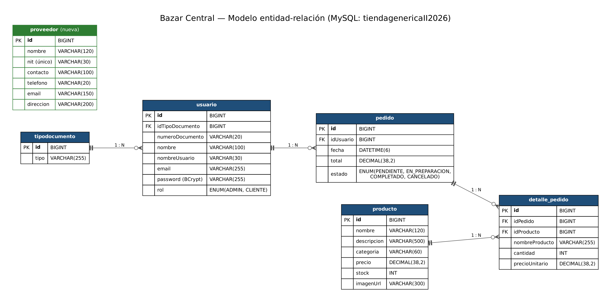

# Bazar Central

Tienda en línea con **backend REST** (Java + Spring Boot) y **frontend web** (HTML, CSS y JavaScript).
Los clientes consultan el catálogo y hacen pedidos; los administradores gestionan productos, usuarios,
pedidos y proveedores.

- **Demo (frontend):** https://ornate-peony-5b796d.netlify.app/
- **Documentación de la API (Swagger):** `http://localhost:8094/swagger-ui.html` (local)
- **Tablero Jira:** _pegar aquí el enlace del tablero_
- **Video / presentación:** _pegar aquí el enlace_

## Integrantes y aportes

| Integrante | CRUD / aporte principal |
|---|---|
| Sebastián García | CRUD de **Productos** y **Usuarios**, autenticación JWT y roles, pedidos, frontend, despliegue |
| Jhoen Felizzola | CRUD de **Proveedores** (`/api/proveedores`) |

> Cada integrante trabajó en su propia rama y entregó mediante Pull Request (ver historial del repositorio).

## Tecnologías

- **Backend:** Java, Spring Boot, Spring Data JPA (Hibernate), Spring Security, Bean Validation
- **Seguridad:** JWT sin sesiones (stateless), contraseñas con BCrypt, roles `ADMIN` y `CLIENTE`
- **Base de datos:** MySQL
- **Documentación de la API:** Springdoc OpenAPI (Swagger UI)
- **Frontend:** HTML, CSS y JavaScript (en la carpeta `frontend/`)
- **Herramientas:** Maven, Git y GitHub, Jira, Railway (backend y base de datos), Netlify (frontend)

## Arquitectura

El backend sigue una arquitectura por capas:

```
controlador  →  servicio  →  repositorio  →  base de datos (MySQL)
   (REST)       (negocio)      (JPA)
```

Paquete base: `uis.edu.entornos.tienda`
`config`, `controlador`, `dto`, `excepcion`, `modelo`, `repositorio`, `seguridad`, `servicio`.

## Diseño de la base de datos



Script de referencia con la estructura completa: [`docs/esquema_bd.sql`](docs/esquema_bd.sql)

| Tabla | Descripción |
|---|---|
| `tipodocumento` | Tipos de documento de identidad |
| `usuario` | Usuarios del sistema (rol `ADMIN` o `CLIENTE`) |
| `producto` | Catálogo de productos y su stock |
| `pedido` | Pedido de un usuario, con estado y total |
| `detalle_pedido` | Productos, cantidades y precios de cada pedido |
| `proveedor` | Proveedores (NIT único) |

Relaciones: un tipo de documento tiene muchos usuarios; un usuario tiene muchos pedidos; un pedido tiene
muchos detalles; un producto aparece en muchos detalles.

## Seguridad y permisos

| Recurso | Quién puede |
|---|---|
| `/api/auth/**`, Swagger | Público |
| `GET /api/productos/**`, `GET /api/tipos-documento/**` | Público |
| `POST`, `PUT`, `PATCH`, `DELETE /api/productos/**` | Solo `ADMIN` |
| `/api/usuarios/**` | Solo `ADMIN` |
| `/api/proveedores/**` | Solo `ADMIN` |
| `GET /api/pedidos/mis-pedidos` | Usuario autenticado |
| `GET /api/pedidos`, `PATCH /api/pedidos/{id}/estado` | Solo `ADMIN` |
| Cualquier otra ruta | Usuario autenticado |

Los endpoints protegidos exigen el encabezado `Authorization: Bearer <token>`.

## CRUDs

| Entidad | Ruta base | Responsable |
|---|---|---|
| Producto | `/api/productos` | Sebastián |
| Usuario | `/api/usuarios` | Sebastián |
| Proveedor | `/api/proveedores` | _Compañero_ |

Operaciones de Proveedor: `GET /api/proveedores`, `GET /api/proveedores/{id}`,
`POST /api/proveedores`, `PUT /api/proveedores/{id}`, `DELETE /api/proveedores/{id}`.

Ejemplo de cuerpo para crear un proveedor:

```json
{
  "nombre": "Distribuidora Santander",
  "nit": "900123456-7",
  "contacto": "Laura Pérez",
  "telefono": "3001234567",
  "email": "ventas@distrisantander.com",
  "direccion": "Cra 27 # 45-10, Bucaramanga"
}
```

## Cómo ejecutarlo en local

**Requisitos:** JDK (versión indicada en `pom.xml`), Maven (o `mvnw`), MySQL (XAMPP sirve), Git.

1. Clonar el repositorio:
   ```bash
   git clone https://github.com/sebasgPayares/bazar-central-backend.git
   cd bazar-central-backend
   ```
2. Crear la base de datos `tiendagenericaII2026` en MySQL (puede ejecutarse `docs/esquema_bd.sql`).
3. Revisar `src/main/resources/application.properties` (usuario y contraseña de MySQL).
   Por defecto: `root` sin contraseña, base en `localhost:3306`.
4. Arrancar el backend:
   ```bash
   ./mvnw spring-boot:run
   ```
5. Abrir `http://localhost:8094/swagger-ui.html`.
6. Para el frontend, abrir `frontend/index.html` o servir la carpeta `frontend/`, y apuntar la constante
   `API_BASE` de `api.js` al backend (`http://localhost:8094/api`).

### Probar los endpoints protegidos

1. Registrar un usuario en `/api/auth/register` e iniciar sesión en `/api/auth/login`.
2. Copiar el token y pegarlo en **Authorize** de Swagger.
3. Para probar rutas de `ADMIN`, el usuario debe tener rol `ADMIN`.

## Flujo de trabajo con Git

- Rama principal: `master`.
- Cada funcionalidad se desarrolla en una rama propia (`feature/...`) y se integra con Pull Request.
- Convención de commits: `feat(...)`, `fix(...)`, `docs(...)`, `chore(...)`.

## Estructura del repositorio

```
bazar-central-backend/
├── docs/                 diagrama y esquema de la base de datos
├── frontend/             interfaz web
├── src/main/java/...     código del backend por capas
├── src/main/resources/   configuración (application.properties)
└── pom.xml
```
