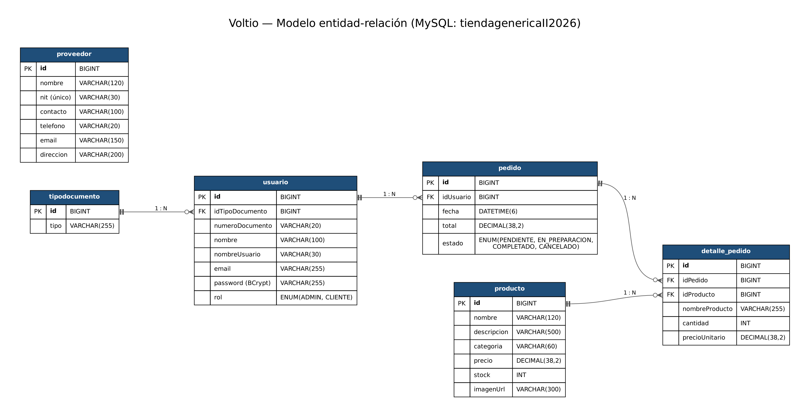

# Voltio — Tecnología que prende

Tienda en línea de tecnología con **backend REST en Spring Boot**, **frontend en React** y base de datos **MySQL**.
Los clientes consultan el catálogo, arman su carrito y hacen pedidos; los administradores gestionan productos,
stock, pedidos y proveedores. La autenticación usa **JWT** con roles `ADMIN` y `CLIENTE`.

Proyecto final de **Desarrollo de Aplicaciones Empresariales** — Tecnología en Desarrollo de Sistemas Informáticos, UTS (Bucaramanga).

| Recurso | Enlace |
|---|---|
| Repositorio | https://github.com/sebasgPayares/bazar-central-backend |
| Aplicación en local | http://localhost:5173 |
| Documentación de la API en local (Swagger) | http://localhost:8094/swagger-ui.html |

La sustentación se hace con el proyecto ejecutándose en local (ver [Cómo ejecutarlo en local](#cómo-ejecutarlo-en-local)).
Durante el semestre también se publicó en Railway (backend y MySQL) y Netlify (frontend); esas direcciones
pueden estar apagadas porque dependen de un plan de pago.

> El proyecto empezó como "Bazar Central" y luego se renombró a "Voltio"; por eso el repositorio y la base de datos
> conservan el nombre anterior.

## Contenido

1. [Integrantes](#integrantes)
2. [Funcionalidades](#funcionalidades)
3. [Tecnologías](#tecnologías)
4. [Arquitectura](#arquitectura)
5. [Base de datos: script y DER](#base-de-datos-script-y-der)
6. [Seguridad: login con JWT](#seguridad-login-con-jwt)
7. [Endpoints de la API](#endpoints-de-la-api)
8. [Frontend en React](#frontend-en-react)
9. [Cómo ejecutarlo en local](#cómo-ejecutarlo-en-local)
10. [Despliegue](#despliegue)
11. [Flujo de trabajo con Git](#flujo-de-trabajo-con-git)
12. [Estructura del repositorio](#estructura-del-repositorio)

## Integrantes

| Integrante | Aporte principal |
|---|---|
| Sebastián García | CRUD de Productos y Usuarios, autenticación JWT y roles, pedidos, frontend (JavaScript y migración a React), despliegue |
| Jhoen David Felizzola Alvear | CRUD de Proveedores (`/api/proveedores`) |

## Funcionalidades

**Cliente (y visitante)**
- Catálogo con buscador y filtros por categoría (público).
- Detalle de producto con stock disponible.
- Carrito lateral guardado por usuario; el carrito de invitado se conserva al iniciar sesión.
- Registro, inicio de sesión y cierre de sesión.
- Compra: crea un pedido, valida y descuenta el stock.
- Historial "Mis pedidos" con el estado de cada pedido.

**Administrador**
- Panel de productos: crear, editar, eliminar y ajustar stock (+10 / -1 venta).
- Gestión de pedidos de todos los clientes: `PENDIENTE` → `EN_PREPARACION` → `COMPLETADO`, o `CANCELADO`
  (cancelar devuelve el stock al catálogo).
- CRUD de proveedores con buscador y NIT único.

## Tecnologías

| Capa | Tecnologías |
|---|---|
| Backend | Java 17 (definido en `pom.xml`), Spring Boot 4.1.1, Spring Web, Spring Data JPA (Hibernate), Bean Validation, Lombok |
| Seguridad | Spring Security, JWT (librería JJWT 0.12.6), BCrypt, sesiones `STATELESS` |
| Base de datos | MySQL / MariaDB |
| Documentación API | Springdoc OpenAPI (Swagger UI) |
| Frontend | React 19, Vite 7, React Router 7, JavaScript, `fetch`, CSS propio (tema oscuro) |
| Despliegue | Railway (backend + MySQL), Netlify (frontend) |
| Herramientas | Maven, Git y GitHub (ramas `feature/*` + Pull Requests), Eclipse, VS Code |

## Arquitectura

```
Navegador (React SPA, Netlify)
        │  fetch + JSON · Authorization: Bearer <token>
        ▼
API REST Spring Boot (Railway)
  controlador  →  servicio  →  repositorio  →  MySQL
    (REST)        (negocio)       (JPA)
        ▲
  seguridad: JwtAuthFiltro + SecurityConfig (roles por ruta)
```

Paquete base del backend: `uis.edu.entornos.tienda`

| Paquete | Contenido |
|---|---|
| `controlador` | Endpoints REST (`AuthControlador`, `ProductoControlador`, `PedidoControlador`, `ProveedorControlador`, `UsuarioControlador`, `TipoDocumentoControlador`) |
| `servicio` | Reglas de negocio (validar stock, calcular totales, cambiar estados) |
| `repositorio` | Interfaces Spring Data JPA |
| `modelo` | Entidades JPA y enums (`Rol`, `EstadoPedido`) |
| `dto` | Objetos de entrada y salida (login, pedidos, usuarios) |
| `seguridad` | JWT, filtro, reglas de acceso y respuestas 401/403 |
| `excepcion` | Excepciones propias y manejador global de errores en JSON |
| `config` | BCrypt, CORS, Swagger y creación del usuario administrador inicial |

## Base de datos: script y DER



| Archivo | Para qué sirve |
|---|---|
| [`docs/esquema_bd.sql`](docs/esquema_bd.sql) | Crea la base `tiendagenericaII2026` y las 6 tablas con sus llaves foráneas |
| [`docs/datos_iniciales.sql`](docs/datos_iniciales.sql) | Inserta los tipos de documento (obligatorios) y productos de ejemplo |
| [`docs/diagrama_bd.png`](docs/diagrama_bd.png) | Diagrama entidad-relación |

| Tabla | Descripción |
|---|---|
| `tipodocumento` | Tipos de documento de identidad |
| `usuario` | Usuarios del sistema, rol `ADMIN` o `CLIENTE`, contraseña cifrada con BCrypt |
| `producto` | Catálogo de productos y su stock |
| `pedido` | Pedido de un usuario, con fecha, estado y total |
| `detalle_pedido` | Productos, cantidades y precio unitario de cada pedido |
| `proveedor` | Proveedores del negocio (NIT único) |

Relaciones: un tipo de documento tiene muchos usuarios; un usuario tiene muchos pedidos; un pedido tiene muchos
detalles; un producto aparece en muchos detalles. `detalle_pedido` guarda el nombre y el precio del producto al
momento de la compra, para que el historial no cambie si luego se edita el producto.

> Hibernate está configurado con `ddl-auto=update`, así que también crea o actualiza las tablas al arrancar.
> Los scripts son la referencia del diseño y permiten montar la base desde cero.

## Seguridad: login con JWT

1. El frontend envía `POST /api/auth/login` con `{ "nombreUsuario", "password" }`.
2. `AuthControlador` busca el usuario y compara la contraseña con BCrypt.
3. Si es correcta, `JwtService` firma un token con el nombre de usuario, el rol y el id; vence a las 24 horas.
4. El frontend guarda la respuesta (`token`, `nombreUsuario`, `nombre`, `rol`) en `localStorage`.
5. Cada petición protegida lleva el encabezado `Authorization: Bearer <token>`.
6. `JwtAuthFiltro` valida la firma y el vencimiento; `SecurityConfig` revisa si el rol puede usar esa ruta.

Respuestas de error en JSON: **401** sin token, token inválido o credenciales incorrectas; **403** rol sin
permiso. El registro público siempre crea usuarios `CLIENTE`. Al arrancar, `DataInitializer` crea un usuario
`admin` si no existe.

| Recurso | Quién puede |
|---|---|
| `/api/auth/**`, Swagger | Público |
| `GET /api/productos/**`, `GET /api/tipos-documento/**` | Público |
| `POST`, `PUT`, `PATCH`, `DELETE /api/productos/**` | Solo `ADMIN` |
| `/api/usuarios/**`, `/api/proveedores/**` | Solo `ADMIN` |
| `GET /api/pedidos/mis-pedidos` | Usuario autenticado |
| `GET /api/pedidos`, `PATCH /api/pedidos/{id}/estado` | Solo `ADMIN` |
| Cualquier otra ruta (por ejemplo `POST /api/pedidos`) | Usuario autenticado |

## Endpoints de la API

| Recurso | Endpoints |
|---|---|
| Autenticación | `POST /api/auth/registro` · `POST /api/auth/login` |
| Productos | `GET /api/productos` · `GET /api/productos/{id}` · `POST /api/productos` · `PUT /api/productos/{id}` · `PATCH /api/productos/{id}/stock?cantidad=N` · `DELETE /api/productos/{id}` |
| Pedidos | `POST /api/pedidos` · `GET /api/pedidos/mis-pedidos` · `GET /api/pedidos` · `GET /api/pedidos/{id}` · `PATCH /api/pedidos/{id}/estado` |
| Proveedores | `GET /api/proveedores` · `GET /api/proveedores/{id}` · `POST /api/proveedores` · `PUT /api/proveedores/{id}` · `DELETE /api/proveedores/{id}` |
| Usuarios | `GET /api/usuarios` · `GET /api/usuarios/{id}` · `POST /api/usuarios` · `PUT /api/usuarios/{id}` · `DELETE /api/usuarios/{id}` |
| Tipos de documento | `GET /api/tipos-documento` · `GET /api/tipos-documento/{id}` |

Ejemplo para crear un pedido (requiere token):

```json
{ "items": [ { "productoId": 1, "cantidad": 2 }, { "productoId": 4, "cantidad": 1 } ] }
```

La documentación completa, con todos los cuerpos y respuestas, está en Swagger.

## Frontend en React

Carpeta [`frontend-react/`](frontend-react/) — aplicación de una sola página (SPA) con Vite y React Router.
Su propio [README](frontend-react/README.md) explica cada archivo.

| Carpeta | Contenido |
|---|---|
| `src/api/` | `cliente.js` (`apiFetch` con `fetch`, token Bearer y errores) y un servicio por recurso |
| `src/context/` | `AuthContext` (sesión), `CarritoContext` (carrito por usuario), `ToastContext` (avisos) |
| `src/routes/` | `RutaProtegida` (exige sesión o rol `ADMIN`) |
| `src/pages/` | Catálogo, Detalle, Login, Registro, Mis pedidos, Panel, Pedidos, Proveedores |
| `src/components/` | Header, Carrito, Tarjeta de producto, Tarjeta de pedido, Layout |

| Ruta | Página | Acceso |
|---|---|---|
| `/` | Catálogo | Público |
| `/producto/:id` | Detalle | Público |
| `/login`, `/registro` | Inicio de sesión y registro | Público |
| `/mis-pedidos` | Historial de compras | Con sesión |
| `/panel`, `/panel/pedidos`, `/panel/proveedores` | Administración | Solo `ADMIN` |

La carpeta [`frontend/`](frontend/) conserva la primera versión en HTML, CSS y JavaScript puro, antes de la
migración a React.

## Cómo ejecutarlo en local

**Requisitos:** JDK 17 o superior, MySQL (XAMPP sirve), Node.js 22 o superior, Git.

### 1. Base de datos

En MySQL (phpMyAdmin o consola), ejecutar en orden:

1. `docs/esquema_bd.sql`
2. `docs/datos_iniciales.sql`

### 2. Backend

```bash
git clone https://github.com/sebasgPayares/bazar-central-backend.git
cd bazar-central-backend
./mvnw spring-boot:run          # en Windows: mvnw.cmd spring-boot:run
```

- También se puede importar en Eclipse como proyecto Maven y ejecutar `ProyectoInicialApplication`.
- Conexión por defecto en `src/main/resources/application.properties`: `root` sin contraseña, `localhost:3306`.
- API: `http://localhost:8094/api` · Swagger: `http://localhost:8094/swagger-ui.html`.
- Al arrancar se crea el usuario `admin` (ver `config/DataInitializer.java`).

### 3. Frontend

```bash
cd frontend-react
npm install
npm run dev                     # abre http://localhost:5173
```

El archivo `.env` apunta al backend que estuvo publicado en Railway. Para usar el backend local, crear
`frontend-react/.env.local` con:

```
VITE_API_URL=http://localhost:8094/api
```

### 4. Probar el login en Swagger

1. Ejecutar `POST /api/auth/login` y copiar el `token`.
2. Pulsar **Authorize** y pegar el token.
3. Probar `GET /api/pedidos/mis-pedidos`: sin token responde 401, con token responde 200.

## Despliegue

Durante el semestre el proyecto se publicó así (hoy puede estar apagado):

| Parte | Plataforma | Cómo se publica |
|---|---|---|
| Backend + MySQL | Railway | Despliegue automático en cada push a `master` |
| Frontend | Netlify | `npm run build` en `frontend-react/` y se sube la carpeta `dist/` (incluye `_redirects` para la SPA) |

En producción conviene definir en Railway la variable `JWT_SECRET` (Spring la usa en lugar de `jwt.secret`),
para que la clave que firma los tokens no sea la del repositorio.

## Flujo de trabajo con Git

- Rama principal: `master`.
- Cada funcionalidad se desarrolla en una rama propia (`feature/...`) y se integra con Pull Request
  (por ejemplo, PR #6 `feature/frontend-react`, migración del frontend a React).
- Convención de commits: `feat(...)`, `fix(...)`, `docs(...)`, `chore(...)`.

## Estructura del repositorio

```
bazar-central-backend/
├── docs/                  script SQL, datos iniciales y DER
├── frontend-react/        frontend actual (React + Vite)
├── frontend/              primera versión del frontend (HTML, CSS y JavaScript)
├── src/main/java/...      backend por capas (uis.edu.entornos.tienda)
├── src/main/resources/    application.properties
├── pom.xml                dependencias Maven
└── README.md              este documento
```
